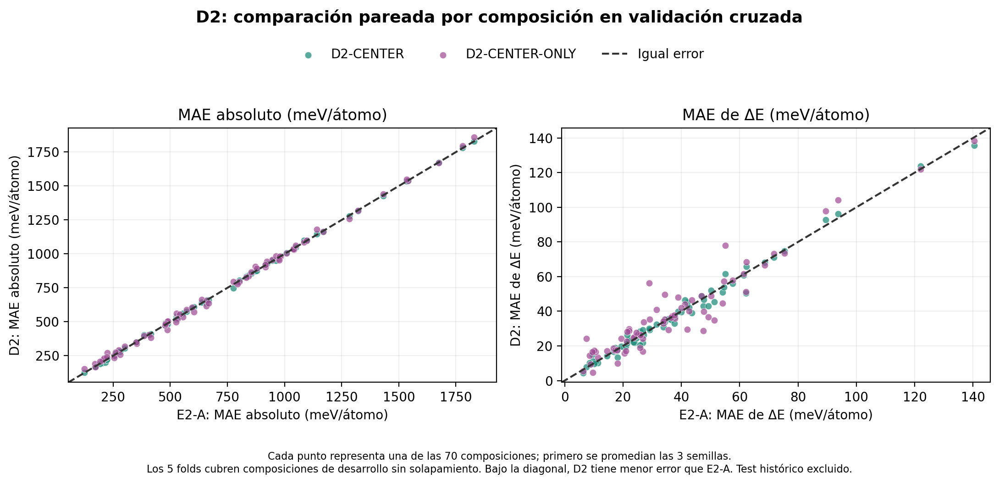
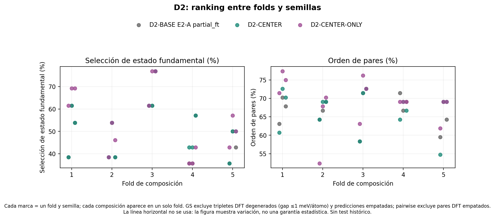
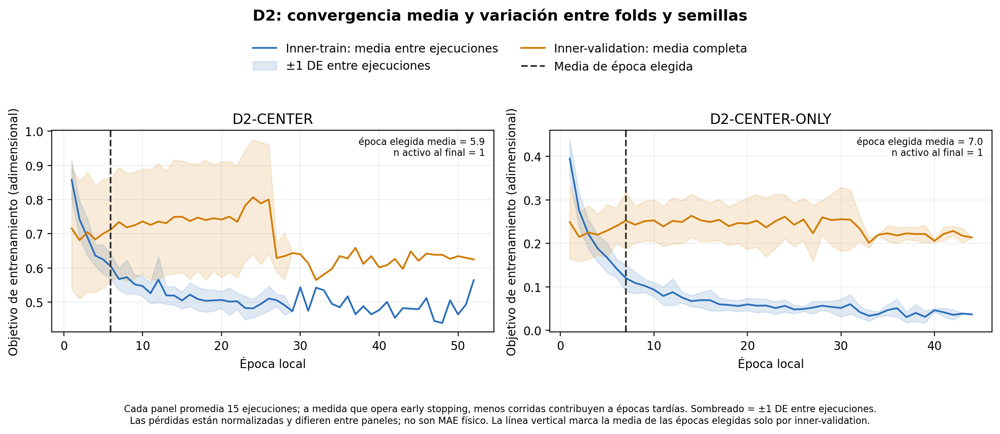

# D2 — ¿ayuda entrenar la energía relativa por triplete?

Estado: **PASS científico / PARTIAL de procedencia** para CV. Se completaron 30 ajustes; el smoke fue una comprobación técnica, no evidencia. Se compara con E2-A partial_ft en los mismos folds y semillas; test histórico excluido.

`D2-CENTER` conserva la pérdida absoluta normalizada y añade SmoothL1 de energías centradas por composición, sustituyendo pairwise. `D2-CENTER-ONLY` usa solo la pérdida centrada. Escalas de energía y centrado proceden solo de inner-train; early stopping usa inner-validation. Mantiene MatGPT unconditional, último bloque ajustable, pooling `<end>`, MLP 768→8→1, AdamW, batch de cuatro composiciones, clipping 1.0 y paciencia 20.

La configuración YAML histórica dice 200 épocas, pero el código E2-A ejecutado fija un máximo real de 100 (smoke de 3); D2 sigue el código ejecutado, con 100 máximas. CENTER-ONLY no aprende offsets absolutos entre composiciones; su salida absoluta usa como offset la media inner-train para poder computar MAE, y no se debe interpretar como una predicción absoluta supervisada.

## Resultados pareados

| Configuración | MAE absoluto: media ± DE fold / semilla (meV/átomo) | MAE ΔE: media ± DE fold / semilla (meV/átomo) | GS (fracción) | Pairwise (fracción) | Colapsos |
|---|---:|---:|---:|---:|---:|---:|
| D2-BASE E2-A partial_ft | 728.9 ± 82.9 / 728.9 ± 4.9 | 37.25 ± 7.24 / 37.25 ± 1.38 | 0.495 | 0.669 | 0/15 |
| D2-CENTER | 728.7 ± 82.9 / 728.7 ± 4.1 | 36.88 ± 7.01 / 36.88 ± 1.62 | 0.509 | 0.667 | 0/15 |
| D2-CENTER-ONLY | 731.7 ± 81.4 / 731.7 ± 2.0 | 38.32 ± 6.47 / 38.32 ± 0.71 | 0.545 | 0.689 | 0/15 |

En la tabla, “DE fold” se calcula sobre cinco medias de fold (cada una promedia tres semillas); “DE semilla” se calcula sobre tres medias de semilla (cada una promedia cinco folds). GS es la fracción macro de composiciones elegibles cuyo mínimo predicho coincide con DFT; se excluye gap DFT ≤1 meV/átomo y una predicción empatada no cuenta como éxito. “Pares” es la exactitud macro de orden de polimorfos, excluyendo pares DFT empatados a ≤1 meV/átomo. Ninguna corrida colapsó según rango predicho medio <1 meV/átomo.

El bootstrap pareado remuestrea las mismas composiciones (3 polimorfos juntos) 2,000 veces; cada composición promedia primero sus tres semillas. Diferencia negativa favorece D2 en error; positiva favorece D2 en GS/pares. IC95% exploratorios:

- D2-CENTER − E2-A: MAE absoluto: -0.22 [-1.82, +1.25] meV/átomo; MAE ΔE: -0.37 [-1.03, +0.28] meV/átomo; GS: +1.49 [-1.49, +4.48] puntos porcentuales; pares: -0.16 [-1.75, +1.43] puntos porcentuales.
- D2-CENTER-ONLY − E2-A: MAE absoluto: +2.72 [-1.76, +7.22] meV/átomo; MAE ΔE: +1.07 [-0.77, +2.89] meV/átomo; GS: +4.98 [+0.50, +9.45] puntos porcentuales; pares: +1.98 [-1.43, +5.24] puntos porcentuales.

Un cambio en GS puede coexistir con ΔE y exactitud pairwise casi iguales: acertar el mínimo de un triplete es una pregunta distinta de reproducir el tamaño de todas sus diferencias. Los intervalos son de desarrollo y no confirman superioridad. No se consultó el test histórico.

Tiempo acumulado de entrenamiento de las 30 cabezas/último bloque: **101.3 min de CPU** (suma de duraciones por ejecución; no incluye preparación/análisis). Media por corrida: **202.7 s**.

En CV, `metrics_mean_by_fold_cv.csv` promedia las tres semillas dentro de cada fold y `metrics_mean_by_seed_cv.csv` promedia los cinco folds dentro de cada semilla. La desviación entre folds mide sensibilidad a qué composiciones quedaron fuera; la desviación entre semillas mide variación de inicialización/orden de entrenamiento en los mismos grupos. No se tratan 15 ejecuciones como 15 muestras químicas independientes.

**Nota de procedencia:** la corrida CV ya estaba iniciada cuando se añadieron al archivo del trainer una columna auxiliar de duración por predicción y una protección para evitar sobrescribir una carpeta no vacía. La pérdida, el optimizador, los folds, las semillas y el criterio de checkpoint no cambiaron. El SHA del trainer al inicio no quedó guardado, por lo que el SHA actual del manifiesto identifica la versión presente y no certifica el bytecode exacto cargado por aquel proceso. La limitación está registrada en `integrity_checks_cv.json`; para trazabilidad de código exacta habría que repetir la CV en una nueva carpeta versionada.

El archivo `training_history_cv.csv` separa objetivo promedio de minilotes inner-train y objetivo completo inner-validation. No son MAE: las curvas están normalizadas y CENTER y CENTER-ONLY contienen distintos términos. La época se selecciona con inner-validation antes de evaluar el fold externo. `training_time_by_run_cv.csv` contiene el tiempo total medido por ejecución y las épocas completadas.

La pérdida centrada y pairwise contienen información diferencial estrechamente relacionada en el límite cuadrático y de pares completos. Cualquier diferencia práctica puede venir de Huber, escalas, reducción, batching o convergencia; no implica señal física nueva.

**Lectura simple:** CENTER prácticamente no cambia el promedio global frente a E2-A. CENTER-ONLY da una mejora pequeña de GS, mientras MAE absoluto y MAE de ΔE cambian poco; el intervalo de GS apenas queda por encima de cero y otras métricas no muestran una mejora clara. La evidencia justifica conservar CENTER-ONLY como hipótesis de ranking para una comparación confirmatoria, pero no como ganador ni como razón suficiente para E2 más complejo. La validation histórica ya intervino en preselecciones anteriores, por lo que un holdout nuevo sería necesario para una afirmación independiente.

## Cómo leer las figuras

- `figures/d2_cv_error_pareado.png`: cada punto es una composición; se promedian sus tres semillas y se comparan los mismos 70 grupos. En la figura izquierda cada coordenada es el MAE absoluto de un triplete; a la derecha, el MAE de las tres ΔE respecto al mínimo DFT. La diagonal marca empate entre métodos. Un punto bajo la diagonal favorece D2 en esa métrica; sobre ella favorece E2-A. La nube de MAE absoluto queda casi encima de la diagonal, lo que muestra que CENTER apenas cambia el error absoluto. En ΔE hay variación por composición y no una mejora uniforme.

- `figures/d2_cv_ranking_folds_semillas.png`: cada punto es una combinación de fold y semilla (15 por modelo). El eje horizontal identifica qué 14 composiciones quedaron fuera en cada fold. El panel GS muestra la selección correcta del polimorfo de menor energía; el panel pairwise muestra la fracción de pares de polimorfos ordenados correctamente. El patrón ayuda a ver si una mejora se repite entre composiciones y semillas. No se dibuja una media de referencia para no ocultar la variación.

- `figures/d2_cv_curvas_entrenamiento.png`: la línea azul es el objetivo de minilotes de entrenamiento y la naranja es el objetivo calculado sobre todos los grupos de inner-validation. Cada panel promedia 15 corridas; las bandas son ±1 desviación estándar. Al avanzar épocas, las corridas que ya activaron early stopping desaparecen de la media; el número activo se anota a la derecha. La línea vertical es la media de la mejor época seleccionada por validation. Estas pérdidas son adimensionales, no son errores en eV/átomo, y las escalas cambian entre CENTER y CENTER-ONLY. Una curva azul descendente con naranja plana o creciente indica que seguir optimizando train no mejora la validación.
