# Auditoría del dominio de preentrenamiento de MatGPT

## Estado: PARTIAL — exposición química cuantificada; procedencia efectiva del split no demostrada

## Resumen

El CSV disponible coincide por nombre con el archivo que declara la configuración unconditional. Contiene **306,533 registros**, con **306,533 cadenas SLICES válidas** y cero nulos en las columnas. El SHA-256 del CSV es `16ae6aae2c3d44a003dab8ca309cbe87ade42f9afa83ddc1da8a437542e116a4`. El vocabulario/checkpoint y el commit de código local coinciden con los valores esperados; el checkpoint conserva el SHA-256 `4318e5fa88a5b177606c792c518251588edf446fa5edb13c35faa08e34d0e414`.

La configuración fija semilla **20260910**, y el código local reproduce `torch.randperm` seguido de un corte 90:10. Aplicado al archivo disponible, el split candidato tiene **275,879 filas de train** y **30,654 de validación**. Lo llamamos *candidato* porque los metadatos del checkpoint no identifican el hash ni el orden exacto del CSV de entrenamiento; no se puede asegurar que estas filas sean las vistas históricamente.

## Calcógenos en el CSV completo

| Elemento | Ocurrencias atómicas | Registros con elemento | Fórmulas reducidas únicas |
|---|---:|---:|---:|
| S | 167,835 | 31,575 | 24,919 |
| Se | 147,076 | 30,762 | 22,956 |
| Te | 96,912 | 23,388 | 17,881 |
| Ba | 45,645 | 20,867 | 16,716 |
| Sr | 43,227 | 20,453 | 15,894 |
| Ca | 39,604 | 19,089 | 14,456 |
| Ti | 12,135 | 6,830 | 5,755 |
| Zr | 9,313 | 5,599 | 4,818 |
| Hf | 8,849 | 5,331 | 4,500 |
| Sn | 22,880 | 12,272 | 10,195 |
| Pb | 27,120 | 13,644 | 11,283 |
| V | 20,067 | 10,235 | 8,510 |
| Nb | 8,851 | 5,138 | 4,285 |

De **306,533** registros válidos, **82,375 (26.87%)** contienen al menos uno de S, Se o Te. Las categorías S, Se y Te se superponen; no deben sumarse como categorías exclusivas. En el train candidato hay 28,466 registros con S, 27,667 con Se, 21,069 con Te y 74,188 con cualquier calcógeno. Son conteos elementales; **no clasifican cada compuesto como sulfuro iónico**.

## Estequiometrías ABX₃

Conteos de registros y entre paréntesis número de fórmulas reducidas distintas:

| Familia por composición | CSV completo | Train candidato | Validación candidata |
|---|---:|---:|---:|
| ABS3 | 48 (39) | 41 (33) | 7 (7) |
| ABSe3 | 56 (34) | 48 (32) | 8 (8) |
| ABTe3 | 17 (11) | 16 (10) | 1 (1) |

La frecuencia de ABS3 es **0.0157%** del CSV completo y **0.152%** entre los registros con S. En el train candidato, ABS3 representa **0.0149%** de las filas, o **0.144%** entre las filas que contienen S. Esta fórmula solo indica composición; no demuestra una estructura perovskita. No se obtuvo evidencia para clasificar topologías geométricas del corpus.

## Solapamiento con ABS₃ de la tesis

El manifiesto histórico contiene 70 composiciones de desarrollo y ocho de test. El cotejo químico usó fórmulas y asignaciones de split; **no cargó etiquetas de energía del test**.

- **11/70** fórmulas de desarrollo tienen al menos un registro exacto en el train candidato; **12/70** aparecen en el CSV completo. Una fórmula adicional aparece solo en la validación candidata.
- **49/70** no tienen coincidencia exacta, pero sí aparece al menos una composición con el mismo conjunto de elementos y otra estequiometría.
- **9/70** no tienen coincidencia exacta ni otra fórmula con ese mismo conjunto de elementos.
- En el control permitido por fórmula del test histórico, **2/8** aparecen en el train candidato. Esto documenta posible exposición composicional; no se consultaron sus energías ni se usaron para selección.
- Entre las **210 estructuras de desarrollo**, hubo **0 coincidencias exactas de cadena SLICES** con el corpus. La tabla de pretraining no contiene CIF; no se pudo verificar equivalencia geométrica con `StructureMatcher`. Cero coincidencias textuales no demuestra ausencia de topologías parecidas.

## Exposición candidata frente a errores OOF de desarrollo

El cruce usa exclusivamente 70 composiciones de desarrollo y resultados OOF ya guardados para H0, H2, R3-DROP30 y R4-SELECTED-ABSOLUTE. La exposición es el número de filas exactas por fórmula en el **train candidato** reconstruido. Cada intervalo es bootstrap percentil del 95% por composición, **2,000 remuestras**, semilla `20261023`.

| Modelo | Spearman: exposición vs MAE absoluto | Spearman: exposición vs MAE ΔE DFT-GS anclada |
|---|---:|---:|
| H0 | 0.40 [0.23, 0.55] | -0.07 [-0.27, 0.13] |
| H2 | 0.26 [0.05, 0.45] | -0.06 [-0.28, 0.16] |
| R3-DROP30 | 0.29 [0.09, 0.47] | -0.04 [-0.23, 0.16] |
| R4-SELECTED-ABSOLUTE | 0.09 [-0.15, 0.32] | 0.01 [-0.22, 0.25] |

La asociación con MAE absoluto es positiva en H0/H2/R3, mientras que R4 es cercana a cero; la asociación con el error de ΔE incluye cero en los cuatro casos. El grupo con coincidencia exacta (11 fórmulas) tampoco muestra menor MAE absoluto promedio:

| Modelo | MAE absoluto exacta vista | MAE absoluto sin match exacto | Diferencia (vista − no vista), IC bootstrap 95% |
|---|---:|---:|---:|
| H0 | 1085.2 | 662.7 | 422.5 [226.9, 610.6] |
| H2 | 475.5 | 329.6 | 146.0 [2.8, 302.4] |
| R3-DROP30 | 509.0 | 341.7 | 167.3 [22.4, 312.4] |
| R4-SELECTED-ABSOLUTE | 175.0 | 149.2 | 25.8 [-44.4, 109.4] |

Esto no demuestra que la exposición empeore el modelo. Los grupos son pequeños, el split es candidato, la dificultad química puede confundir la asociación, y R1–R4 fueron seleccionados usando parte de development. Las correlaciones son exploratorias y no causales. No encontramos señal de que más ejemplos de fórmula exacta reduzcan el error de ranking; para H0/H2/R3 los rangos de ΔE no muestran relación precisa con frecuencia.

## Lectura de las hipótesis

- **H-DOM1 (calcógenos ausentes/subrepresentados):** rechazada en su versión de ausencia: 26.87% de filas contienen S/Se/Te. No se evalúa si son subrepresentados respecto de una distribución de referencia adecuada.
- **H-DOM2 (pocos ABS₃):** compatible con los conteos: 48 registros ABS3 en el CSV completo, 41 en el train candidato y 33 fórmulas distintas en ese train. La exposición de las composiciones objetivo exactas es baja (11/70 candidatas), aunque la exposición química por elementos es amplia.
- **H-DOM3 (falta de diversidad topológica):** no resuelta. Hay variación en registros por composición, pero el CSV no aporta CIF ni clasificación polimórfica comparable. Las cadenas SLICES exactas objetivo no se repiten.
- **H-DOM4 (objetivo generativo no optimizado para ΔE):** sigue siendo plausible, no probado por esta auditoría. La exposición exacta no se asocia de forma clara con el error de ΔE; el objetivo de preentrenamiento y la supervisión energética pueden ser determinantes, junto con representación, cabeza y tamaño de muestra.

## Conclusión científica

Hay exposición química sustancial a calcógenos en el corpus disponible, pero poca coincidencia exacta con las composiciones ABS3 objetivo en el train candidato y ninguna repetición exacta de las SLICES de desarrollo. Los datos son compatibles con **cambio de dominio composicional a nivel de fórmula**, pero no prueban ausencia de estructuras/topologías parecidas ni que el domain shift cause el MAE observado. Las asociaciones por fórmula no apuntan a menor error al aumentar la frecuencia exacta; por tanto, el resultado favorece investigar el objetivo de preentrenamiento y qué información estructural retiene el embedding, sin descartar que una adaptación de dominio futura pueda ayudar.

**No recomendaría todavía un reentrenamiento completo.** El siguiente paso probatorio sería verificar con el proveedor el hash y orden del CSV histórico, y obtener CIF/metadatos estructurales del corpus para comparar prototipos. Si se confirma baja cobertura de ABS3 específica, evaluar después una adaptación causal SLICES controlada, sin mezclarla con el benchmark energético.

## Alcance y limitaciones

1. `CONFIG_REPRODUCED`, no `VERIFIED`: el checkpoint no trae hash del corpus ni manifiesto de filas; la semilla no acredita el archivo exacto usado.
2. El CSV carece de CIF y de energía DFT para esta tarea. No se calculó equivalencia geométrica ni se interpretó `e_form` como energía de polimorfos.
3. El parser lee especies del bloque inicial de sitios y valida que las aristas posteriores sean tripletes con índices y vectores válidos. Aceptó todas las filas. Los conteos químicos no identifican valencia o carácter iónico.
4. La validación de patrones OOF reutiliza métricas del estudio R1–R4 sobre el mismo desarrollo donde se hizo selección; no es una evaluación confirmatoria.
5. El test histórico se usó únicamente para cotejo de fórmula como control de posible contaminación. Sus etiquetas DFT no se leyeron.
6. No se entrenó ni modificó MatGPT.

## Figuras

Todas las figuras son PNG creadas desde las tablas de esta auditoría. Incluyen denominadores y límites de interpretación en las notas.

- 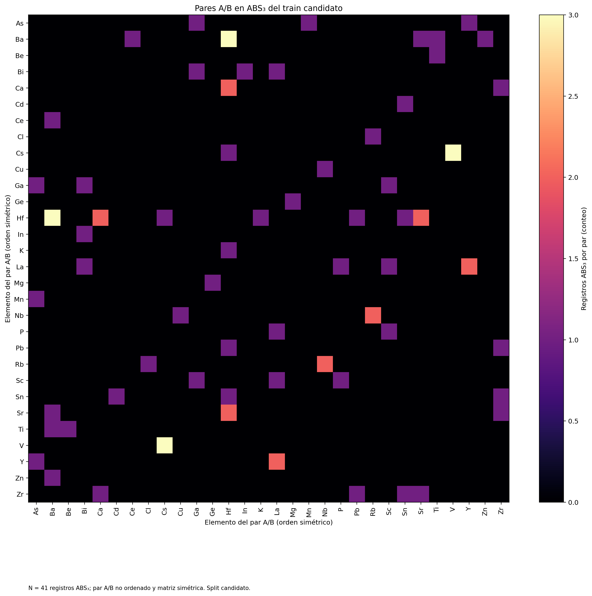
- 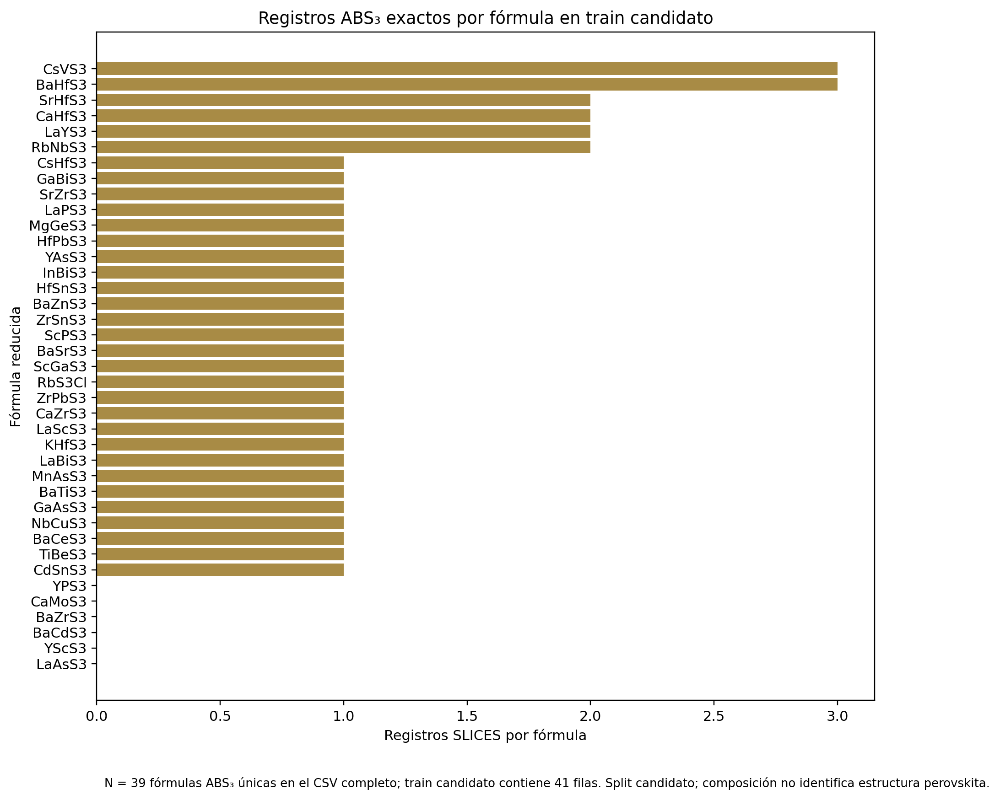
- 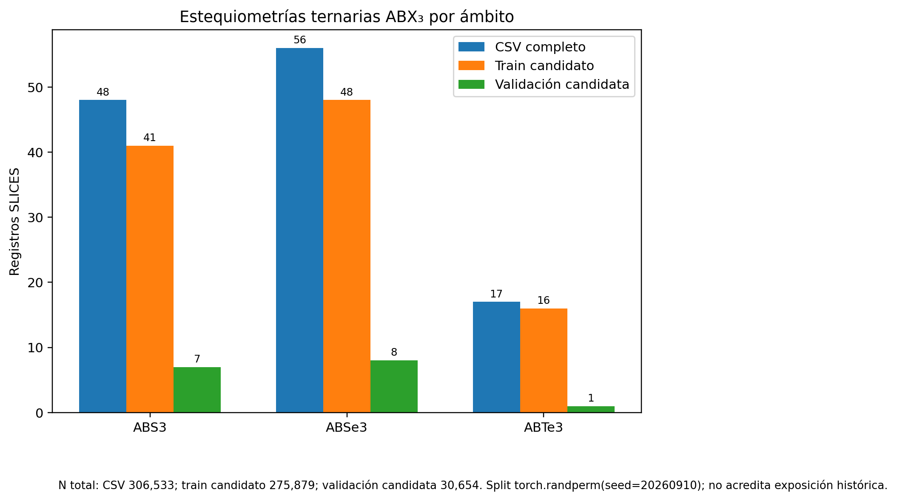
- 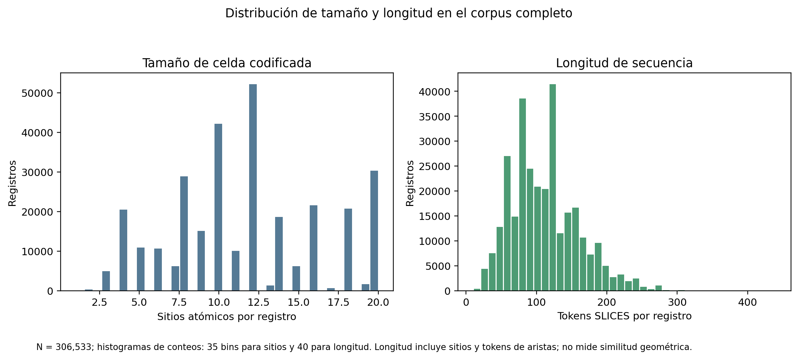
- 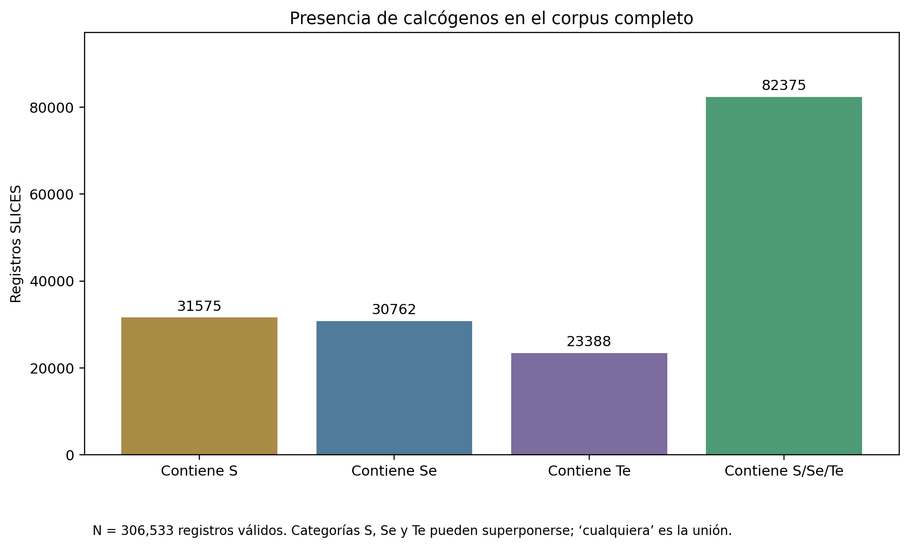
- 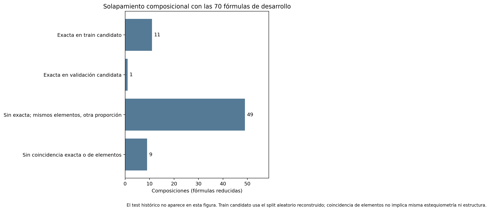
- 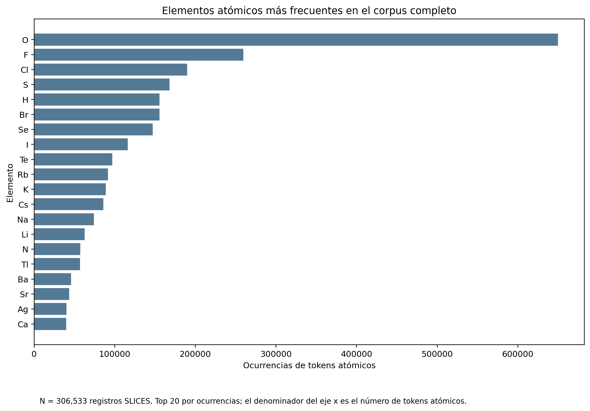
- 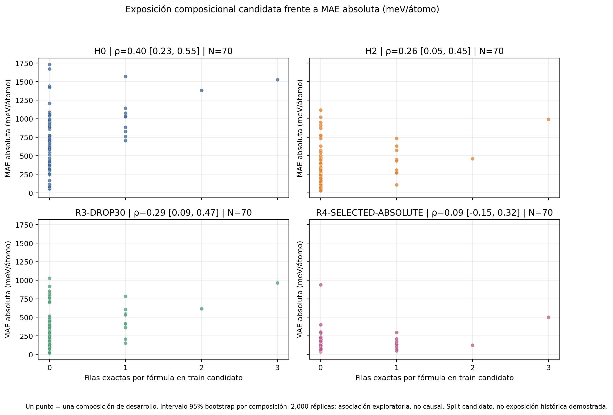
- 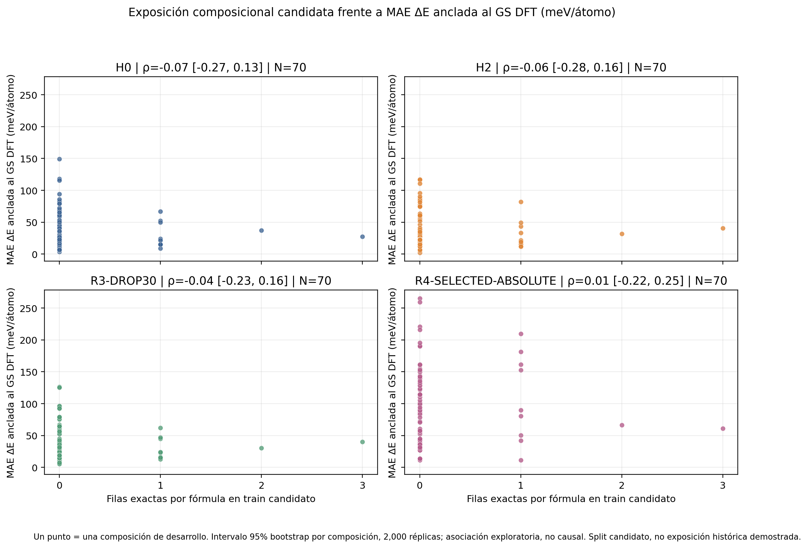
- 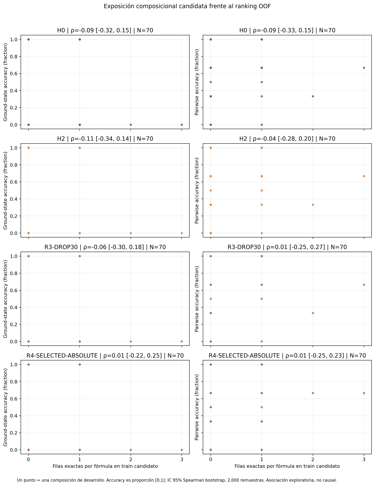
- 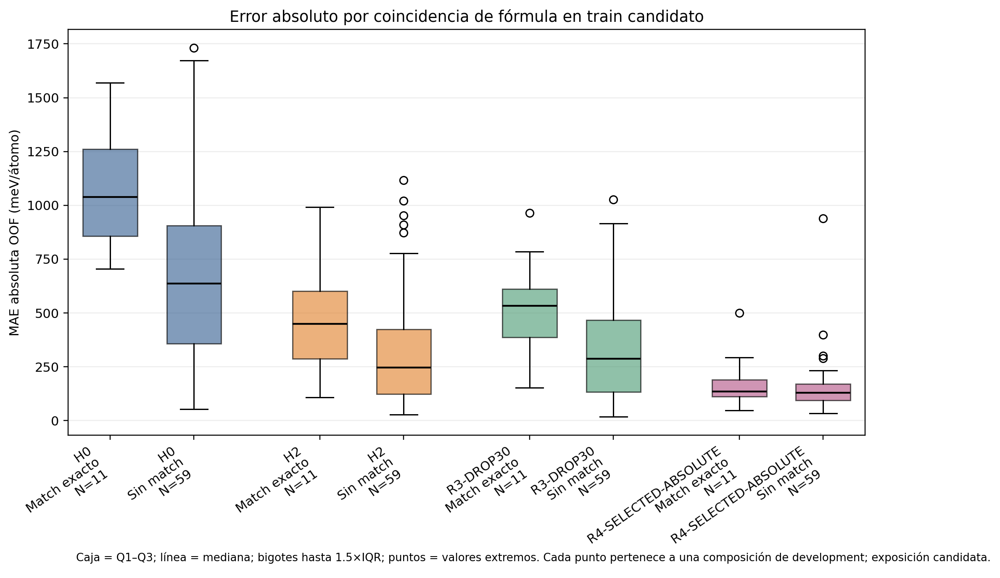

## Artefactos reproducibles

- [Manifiesto](manifest.json)
- [Procedencia](provenance/provenance.json)
- [Esquema del corpus](corpus_statistics/corpus_schema.json)
- [Estadísticas de calcógenos](corpus_statistics/chalcogenide_statistics.json)
- [Estadísticas ABX₃](corpus_statistics/abs3_corpus_statistics.json)
- [Asignación candidata torch.randperm](corpus_statistics/reconstructed_split_assignments.csv)
- [Solapamiento composicional](domain_overlap/abs3_composition_overlap.csv)
- [Solapamiento SLICES exacto](structural_overlap/structural_overlap.csv)
- [Correlaciones OOF por composición](error_correlations/spearman_bootstrap.csv)

## Referencias

- MatGPT, código oficial y configuración unconditional: [repositorio](https://github.com/devalab/matgpt), [configuración](https://github.com/devalab/matgpt/blob/main/mat-concat/config/uncond.yaml), [entrenamiento](https://github.com/devalab/matgpt/blob/main/mat-concat/train.py). La auditoría usa el commit local fijado `a2eaee254bc829f0cc19edce5cbf27bbc3d35d5e`.
- Dataset asociado por la documentación del proyecto: [Figshare DOI 10.6084/m9.figshare.34330655](https://doi.org/10.6084/m9.figshare.34330655). El archivo local se verificó por nombre/configuración y SHA; no hay hash de publicación contrastado.
- Xiao et al., SLICES, *Nature Communications* 14, 7027 (2023), [doi:10.1038/s41467-023-42870-7](https://doi.org/10.1038/s41467-023-42870-7).
- Witman y Schindler, MatFold, *Digital Discovery* 4, 625–635 (2025), [doi:10.1039/D4DD00250D](https://doi.org/10.1039/D4DD00250D).
- MatterGPT Zenodo es un dataset distinto: [doi:10.5281/zenodo.16879675](https://doi.org/10.5281/zenodo.16879675); no se usó como sustituto.
