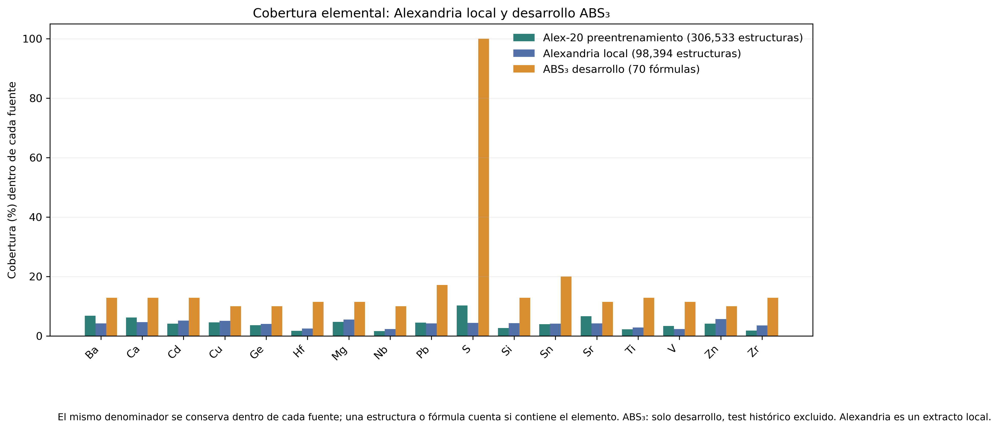
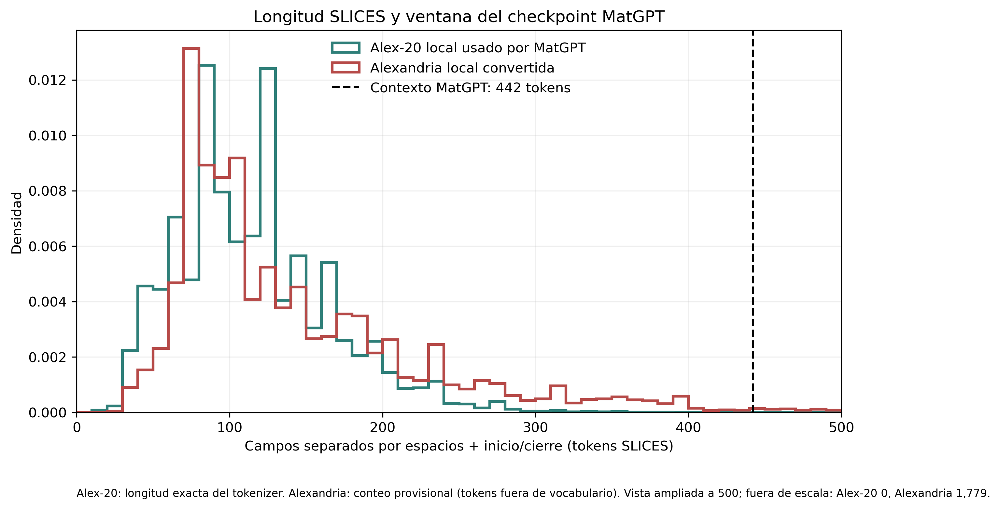
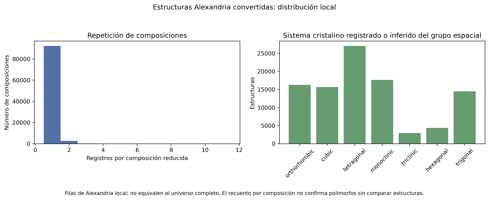
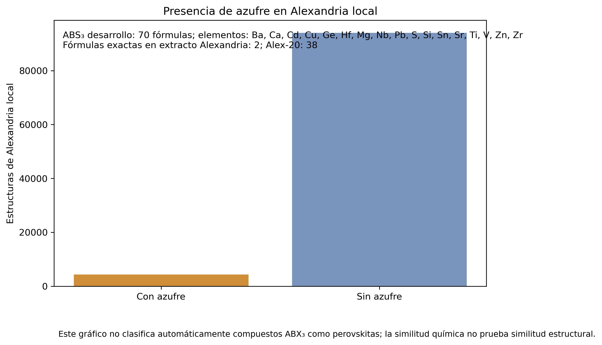
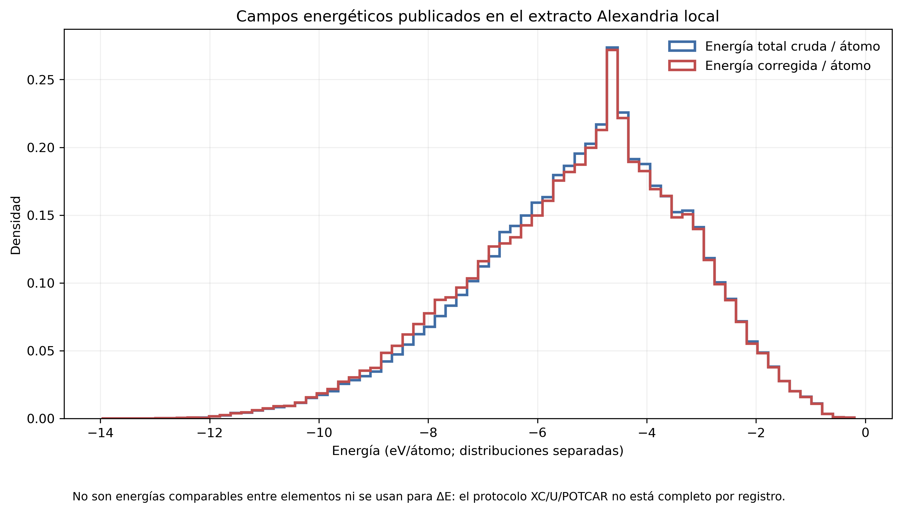
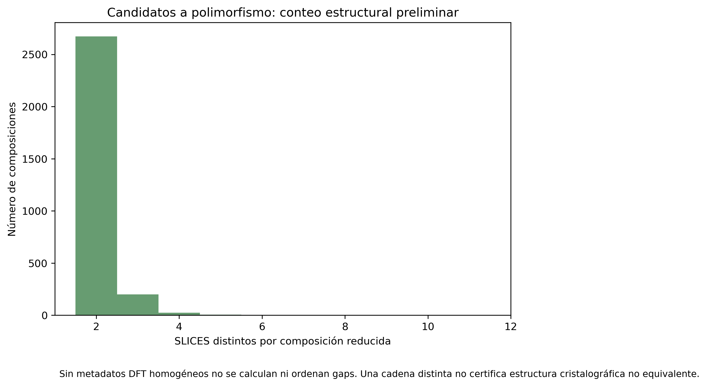

# Auditoría Alexandria–MatGPT para transferencia energética

**Estado de auditoría:** `CONDITIONAL`  
**Viabilidad energética supervisada:** `NO_GO_PENDING_DFT_PROTOCOL_AND_TEST_EXCLUSION`  
**Viabilidad intrafórmula:** `NO_GO_PENDING_COMPARABLE_MULTISTRUCTURE_DFT_AND_TEST_EXCLUSION`  
**Continued pretraining:** `CONDITIONAL_GO_ONLY_FOR_VERIFIED_NOVEL_TOKENIZER_COMPATIBLE_SUBSET`

## Resumen

**HECHO VERIFICADO.** El checkpoint auditado es el modelo **MatGPT incondicional** del repositorio `devalab/matgpt`, archivo `mat-concat/mat-uncond/weights/transformer_property_0.pth`, SHA-256 `4318e5fa88a5b177606c792c518251588edf446fa5edb13c35faa08e34d0e414`. Tiene 12 bloques, dimensión oculta 768, 12 cabezas, vocabulario de 172 entradas y ventana `442`. El código y la configuración local `uncond.yaml` identifican `Training_dataset_alex20_with_encoding.csv` como entrada del entrenamiento sin propiedades condicionantes.

**EVIDENCIA DOCUMENTAL.** El README oficial de MatGPT describe Alex-20/MatterGPT como fuente de los datos de formación de energía y gap y publica el CSV de entrenamiento. El archivo local contiene 306,533 filas y 306,533 IDs. El modelo incondicional usa el corpus de SLICES para objetivo autoregresivo; este checkpoint no fue supervisado con energía durante ese entrenamiento. El hash del CSV no está incrustado en los pesos, por lo que la identidad exacta de cada ejemplo original se marca `PARTIALLY_VERIFIED (config/README + local Alex-20 file; checkpoint does not embed its dataset hash)`. Esto no debe confundirse con MatterGPT: ambos proyectos comparten procedencia Alex-20 documentada, pero sus checkpoints, implementaciones y objetivos son diferentes.

**RESULTADO ESTADÍSTICO.** El extracto local `alexandria_clean_strict.csv` tiene 98,394 filas, 98,394 filas marcadas SLICES válidas y 0 secuencias compatibles con el tokenizer y ventana exactos de MatGPT sin truncamiento. El archivo no es la base Alexandria completa.

**RESULTADO DE SOLAPAMIENTO.** Se encontraron 5397 IDs exactos en ambos: extracto local estricto y Alex-20 usado como corpus documentado. También coinciden exactamente 0 hashes de SLICES normalizados. Por tanto, la fracción local ya vista por el preentrenamiento es 5.5% para IDs y 0.0% para secuencias; la parte nueva exacta solo puede declararse para el extracto comparado, no para Alexandria completo.

**LIMITACIÓN DE ACCESO.** No se usó ninguna etiqueta ni resultado del test histórico. Durante el inventario inicial se mostró accidentalmente una vista previa de un solo registro de `data/raw_data/results(1).json`, antes de reconocer que podría contener datos ABS₃ protegidos. Se excluyó totalmente y no se volvió a abrir. No se puede afirmar que el archivo no se haya leído; la auditoría no incorpora ese contenido. El manifiesto autorizado de exclusión tampoco está disponible. Cualquier entrenamiento futuro debe permanecer bloqueado hasta verificar las exclusiones.

## Fuentes y procedencia del modelo

| Fuente | Observación |
|---|---|
| Checkpoint | `models/MatGPT-source/mat-concat/mat-uncond/weights/transformer_property_0.pth`; SHA-256 `4318e5fa88a5b177606c792c518251588edf446fa5edb13c35faa08e34d0e414` |
| Configuración | `mat-concat/config/uncond.yaml`; conditioning `unconditional`, propiedades seleccionadas vacías |
| Arquitectura | 12 bloques, 768 dimensiones, 12 cabezas; 114,026,668 parámetros verificados por carga histórica |
| Tokenizer | `models/MatGPT-source/mat-concat/mat-uncond/weights/model_info_property_0.json`, SHA-256 `d0948d7ba6fe010c23b99755d71dc9546558b950509b02a7cccef73eb2f15dee`; block size 442 |
| Corpus que declara la configuración | `Training_dataset_alex20_with_encoding.csv`, local, 306,533 filas |
| Trazabilidad de la versión exacta | `PARTIALLY_VERIFIED (config/README + local Alex-20 file; checkpoint does not embed its dataset hash)`; no hay hash del CSV ligado a checkpoint |

El modelo es **MatGPT**, no MatterGPT. La publicación de MatterGPT reporta Alex-20 como corpus de SLICES para su entrenamiento; la documentación de MatGPT local también lo señala como CSV de entrada. En la ejecución que se audita, el YAML declara un modelo incondicional y `selected_properties: []`: la evidencia local apoya el aprendizaje de secuencias estructurales, no de energías como objetivo de ese checkpoint.

## Inventario y compatibilidad SLICES

- CSV MatGPT/Alex-20: 306,533 registros; compatibles tokenizer: 306,533; dentro de contexto: 306,533; listos: 306,533. Fórmulas derivadas de la lista inicial de especies de SLICES, terminada en el primer índice entero: 239,188.
- CSV Alexandria estricto local: 98,394; SLICES marcado válido por el export: 98,394; compatible tokenizer: 0; secuencias que podrían caber por conteo de campos whitespace (no tokenizer válido): 96,026; listo para MatGPT: 0.
- Block size exacto: 442 incluidos `<start>` y `<end>`. No se truncaron secuencias.
- Estrategia de conversión local: no se halló un script de conversión/manifiesto versionado junto a los CSV. El formato del export local incluye prefijos y etiquetas adicionales; no se presume equivalencia con estrategia 4 de MatGPT. Se requiere verificar el código/versión de conversión antes de usarlo.
- Vocabulario original de MatGPT admite los tokens estructurales de Alex-20. La conversión Alexandria local muestra 0/98,394 filas compatibles exactas. Tokens fuera de vocabulario frecuentes: `[('o', 98394), ('OOO', 84541), ('+', 72310), ('c', 65513), ('b', 60234), ('a', 53066), ('w', 41702), ('g', 22542), ('x', 22358), ('DDO', 22288)]`.

## Cobertura química y estructural

Elementos observados en extracto estricto: Ac, Ag, Al, As, Au, B, Ba, Be, Bi, Br, C, Ca, Cd, Ce, Cl, Co, Cr, Cs, Cu, Dy, Er, Eu, F, Fe, Ga, Gd, Ge, H, He, Hf, Hg, Ho, I, In, Ir, K, La, Li, Lu, Mg, Mn, Mo, N, Na, Nb, Nd, Ni, Np, O, Os, P, Pa, Pb, Pd, Pm, Pr, Pt, Pu, Rb, Re, Rh, Ru, S, Sb, Sc, Se, Si, Sm, Sn, Sr, Ta, Tb, Tc, Te, Th, Ti, Tl, Tm, U, V, W, Xe, Y, Yb, Zn, Zr. Desarrollo ABS₃: 70 fórmulas; elementos Ba, Ca, Cd, Cu, Ge, Hf, Mg, Nb, Pb, S, Si, Sn, Sr, Ti, V, Zn, Zr. El registro de azufre cuenta 4,363 estructuras, pero no basta para acreditar transferencia de ordenamiento polimórfico. Se encontraron 2 fórmulas exactas del desarrollo ABS₃ en el extracto local. Esta comparación cubre únicamente desarrollo y no abre test.

El sistema cristalino usa la columna directa de Alex-20 cuando existe; para Alexandria se infiere del número de grupo espacial mediante intervalos cristalográficos estándar. No equivale a una etiqueta de prototipo. SLICES diferentes y prototype_id diferente son indicios para revisión, no prueba de estructuras no equivalentes. En el CSV de entrenamiento local, nsites llega a 80; 428 filas superan 20 sitios. La comprobación de nsites frente a la lista inicial de especies fue evaluable en 306,533 filas y discrepó en 4,132. No se debe interpretar nsites como número de átomos de celda primitiva sin confirmar el esquema del CSV. No se ejecutó StructureMatcher en todo el corpus; no se realizaron comparaciones cuadráticas.

## Energías DFT y polimorfismo

El CSV conserva `energy`/`energy_total`, `energy_corrected`, `correction`, `energy_per_atom`, `energy_corrected_per_atom`, `e_form` y `e_above_hull`. `e_form` y `e_above_hull` no se sustituyeron por energía total. Donde fue necesario, eV/átomo se auditó como E_total/N.

En el archivo estructural local, los campos por registro para XC, POTCAR y Hubbard U no están disponibles: el JSON original tiene `parameters` vacío en 0/100,000 registros y no ofrece en el extracto un funcional/U verificable. `energy` coincide con `data.energy_total` en 100,000/100,000 filas; hay correction distinta de cero en 99,578/100,000. `energy_corrected` es campo separado. Se clasifica el protocolo como `DFT_PROTOCOL_UNKNOWN`, no como PBE homogéneo. Se mantienen crudas y corregidas separadas. No se computan gaps físicamente comparables ni rankings a partir de registros heterogéneos. Las estadísticas de rango y consistencia están en `metrics.json`; los valores eV/átomo se calcularon dividiendo el total correspondiente por N, nunca mezclando targets.

Conteo de composición repetida en el extracto: 2,908 fórmulas tienen más de un registro; el número de entradas por fórmula y de hashes SLICES se exporta en `estadisticas_polimorfismo.csv`. Estos son **candidatos** a multiestructura, no un conteo certificado de polimorfos energéticamente comparables. El objetivo de aprendizaje intrafórmula no se puede aprobar con la evidencia DFT local actual.

## Duplicados, novedad y leakage

- IDs exactos compartidos con Alex-20: 5,397 de 98,394 filas del extracto (5.5%).
- Hashes SLICES exactos compartidos tras normalizar espacios: 0.
- Composiciones reducidas compartidas entre Alexandria local y Alex-20 (Alex-20 derivado del prefijo de especies; Alexandria de fórmula explícita): 8,731 de 95,183.
- De los IDs repetidos, la secuencia normalizada coincide exactamente en 0; en 5,397 el ID es igual pero serialización SLICES difiere. Es probable que corresponda a conversiones/versiones distintas, no se deduce equivalencia solo del texto.
- Misma composición ABS₃ desarrollo: 2 fórmulas en Alexandria local; esas fórmulas deben excluirse del entrenamiento intermedio inductivo.
- Equivalencia estructural: no verificada sistemáticamente para todo el extracto.
- Test histórico: no se usó ninguna etiqueta; ocurrió una vista previa accidental y excluida de un registro potencialmente protegido. Manifiesto de fórmulas excluidas no localizado. Estado futuro: `TRANSFER_TRAINING_BLOCKED_PENDING_HOLDOUT_EXCLUSION`.

La novedad respecto a MatGPT solo es cuantificable sobre la pareja local comparada (IDs/SLICES exactos). No se puede afirmar novedad frente al corpus Alexandria global, ni equivalencia del estado estructural por coincidencia solo de fórmula.

## Evaluación de estrategias futuras

| Estrategia | Estado | Fundamento |
|---|---|---|
| A. Continued pretraining autoregresivo | `CONDITIONAL_GO_ONLY_FOR_VERIFIED_NOVEL_TOKENIZER_COMPATIBLE_SUBSET` | Alex-20 ya es el corpus estructural documentado de MatGPT y sus secuencias son compatibles. Alexandria local convertida tiene 0 filas compatibles con el tokenizer actual; solo cabe evaluar una conversión/reconversión compatible y deduplicada fuera de Alex-20. No repetir el corpus sin filtrarlo por solapamiento. |
| B. Adaptación energética supervisada amplia | `NO_GO_PENDING_DFT_PROTOCOL_AND_TEST_EXCLUSION` | Existen campos de energía, pero protocolo XC/U/POTCAR no verificable por fila y no existe exclusión autorizada del test. `e_form` no es energía total. |
| C. Adaptación intrafórmula/pairwise | `NO_GO_PENDING_COMPARABLE_MULTISTRUCTURE_DFT_AND_TEST_EXCLUSION` | Hay composiciones repetidas/SLICES candidatos, pero no se certifican equivalencia de estructura ni comparabilidad energética entre cálculos. No se pueden construir gaps DFT válidos todavía. |

## Subconjuntos candidatos

Los filtros y conteos están en `subconjuntos_candidatos.csv`. Ningún candidato queda habilitado para entrenamiento ABS₃ hasta resolver la exclusión de todas las fórmulas del test. Un subconjunto de secuencias podría ser útil para un estudio de continued pretraining solo si se deduplica por IDs/SLICES contra Alex-20 y se demuestra que la conversión usa la misma serialización/tokenizer. El subset energético necesita trazabilidad de campaña DFT antes de definir tamaño.

## Dictamen

**No conviene iniciar primero un nuevo continued pretraining con el Alexandria local en bruto:** el checkpoint MatGPT auditado ya se entrenó autoregresivamente en Alex-20, derivado de Alexandria, y una parte cuantificable del extracto local solapa exactamente con ese corpus. Un continued pretraining solo tendría hipótesis razonable si se identifica una fracción realmente novedosa, compatible, con serialización estable y exclusiones de evaluación completas.

**No se recomienda aún adaptación energética supervisada ni aprendizaje intrafórmula.** Los datos locales contienen labels de energía útiles como candidatos, pero no se verifican el protocolo DFT común y sus correcciones por registro y falta una lista autorizada para bloquear todas las composiciones de evaluación ABS₃. Primero hay que recuperar metadatos de cálculo/funcional/POTCAR y el manifiesto de exclusión del test; entonces volver a evaluar un subset con energías homogéneas.

### Clasificación de conclusiones

- **HECHO VERIFICADO:** checkpoint/hash, YAML `unconditional`, 172 tokens, block_size 442, configuración local apunta a Alex-20.
- **EVIDENCIA DOCUMENTAL:** MatGPT y MatterGPT describen Alex-20 como corpus derivado de Alexandria; no implica que ambos checkpoints o objetivos sean iguales.
- **RESULTADO ESTADÍSTICO:** tamaños, tokens listos, overlap exacto y cobertura vienen de las fuentes locales y CSV anexos.
- **INFERENCIA:** el nuevo continued pretraining sobre datos ya vistos tendría novedad limitada; supervisión DFT podría añadir tipo de señal distinto, si etiquetas homogéneas.
- **HIPÓTESIS:** un subset Alexandria no visto y energéticamente coherente podría ayudar a estabilizar adaptación ABS₃.
- **INFORMACIÓN NO DISPONIBLE:** corpus/hash exacto empaquetado en pesos; homogeneidad completa DFT; equivalencia estructural de candidatos; exclusión autorizada del test histórico.

## Figuras

## Referencias

1. MatGPT, repositorio y datos/checkpoints: https://github.com/devalab/matgpt y https://doi.org/10.6084/m9.figshare.34330655
2. MatterGPT: https://doi.org/10.48550/arXiv.2408.07608
3. Alexandria database: https://alexandria.icams.rub.de/ (PBE/PBEsol/SCAN y otras colecciones; no intercambiables sin control de protocolo).
4. SLICES: Xiao et al., https://doi.org/10.1038/s41467-023-42870-7
5. Material local: `models/MatGPT-source/README.md`, `mat-concat/config/uncond.yaml`, `mat-concat/mat-uncond/weights/model_info_property_0.json`.
