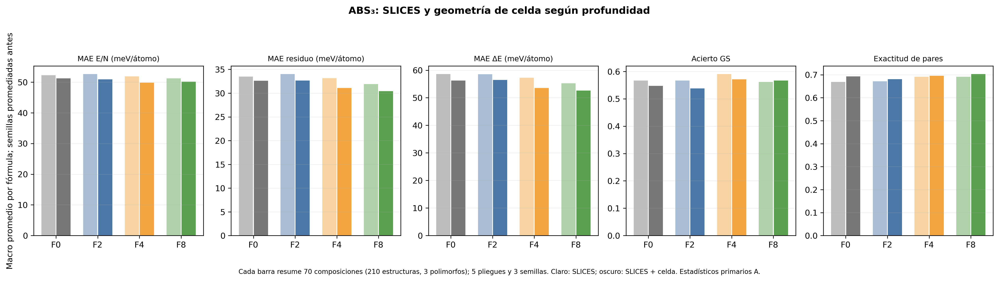
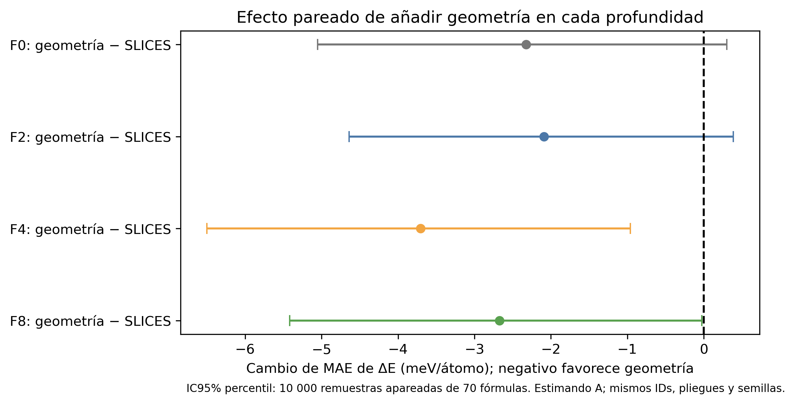
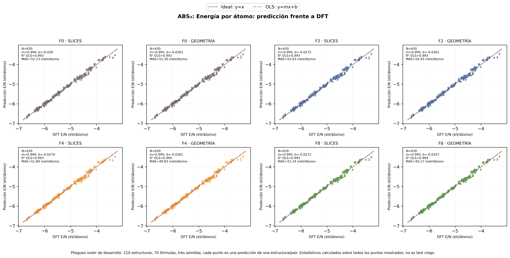
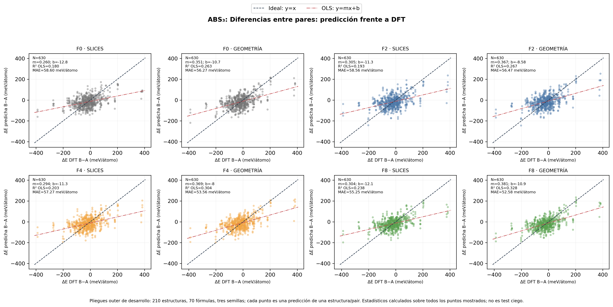

# Experimento D — fine-tuning de MatGPT con SLICES y geometría de celda

## Estado y pregunta

**Resultado experimental completado en evaluación de desarrollo, no en un test ciego.** La pregunta es si siete descriptores métricos de celda mejoran las diferencias energéticas al adaptar bloques superiores de MatGPT. No se usó geometría como tokens: se concatenó después de FINAL_END.

## Procedencia y protocolo

- Geometrías: 210 de 210 IDs, procedencia uniforme `{'gga-static_endpoint_cleaned': 210}`; SHA-256 `5be78f0e6282f0b5df4aeff8f54950e2f07750bd290a72444fb09b44aeec6eb8`. Son celdas estáticas DFT; `static` no certifica relajación completa ni disponibilidad en inferencia SLICES-only.
- Dataset: 210 estructuras / 70 fórmulas; 3 polimorfos, 5 pliegues y 3 semillas. Train/validation/outer son grupos por composición (45/11/14 por pliegue). No se leyó el test histórico.
- MatGPT: checkpoint SHA-256 `4318e5fa88a5b177606c792c518251588edf446fa5edb13c35faa08e34d0e414`; 12 bloques, hidden 768. MLP8 geométrica 775→8→1 (6,217 parámetros); cabeza SLICES 768→8→1 (6,161). Los 56 pesos extra empezaron en cero y el resto copió la inicialización semilla-específica del control.
- Ridge: se reutilizaron los cinco Ridge composicionales sin reentrenar; dispersión entre salidas por condición = 0 eV/átomo. La normalización de geometría se ajustó por pliegue con las 135 estructuras de 45 fórmulas inner-train.
- Controles: F0 SLICES/geom se reutilizan del estudio congelado apareado, reemplazando su Ridge de embeddings por la media Ridge composicional fija; F2/F4/F8 SLICES-only se reutilizan de la ablación de profundidad. Nuevas corridas: 45 geometría F2/F4/F8. Los controles se preservan como archivos fuente.
- Targets: solo residuo DFT por átomo centrado dentro del triplete; SmoothL1 β=1 normalizada por escala inner-train. El checkpoint se seleccionó por pérdida completa de inner-validation. Sin LoRA, fuerzas, estrés, pérdida pairwise ni nuevos descriptores.

## Resultados principales (estimando A)

A calcula cada métrica por semilla y promedia dentro de fórmula; 70 fórmulas son la unidad bootstrap. B promedia primero las predicciones por estructura y se mantiene separado en `metrics.json`.
| Profundidad | MAE ΔE SLICES | MAE ΔE geometría | Cambio geom − SLICES | MAE residuo SLICES | MAE residuo geom | GS SLICES / geom | Pares correctos SLICES / geom |
|---|---:|---:|---:|---:|---:|---:|---:|
| F0 | 58.60 | 56.27 | -2.32 | 33.49 | 32.60 | 0.567 / 0.548 | 0.663 / 0.687 |
| F2 | 58.56 | 56.47 | -2.09 | 34.02 | 32.65 | 0.567 / 0.538 | 0.663 / 0.675 |
| F4 | 57.27 | 53.56 | -3.71 | 33.16 | 31.08 | 0.590 / 0.571 | 0.685 / 0.690 |
| F8 | 55.25 | 52.58 | -2.67 | 31.91 | 30.40 | 0.562 / 0.567 | 0.687 / 0.695 |

Los números de errores están en meV/átomo; GS es proporción exacta sobre 70 fórmulas. Los conteos pairwise se reconstruyeron directamente; no se derivan de tasas redondeadas.

## Contrastes, incertidumbre e interacciones

Los IC son percentiles bootstrap apareados por 70 fórmulas, 10,000 réplicas. Contrastes por profundidad son exploratorios y los IC individuales no están ajustados por multiplicidad; se aplica Holm a los cuatro efectos principales de geometría sobre MAE ΔE y se reportan sus valores en `bootstrap_contrastes.csv`.
- Efectos principales: ver [figura de efectos](../../../images/MatGPT_SLICES_Geometria_Finetuning_Profundidad/efecto_geometria_por_profundidad_intervalos_confianza.png).
- Interacción: (MAE geom−MAE SLICES) en profundidad − mismo contraste F0; negativo significa que la geometría beneficia más (o perjudica menos) que en F0. Ver [figura de interacción](../../../images/MatGPT_SLICES_Geometria_Finetuning_Profundidad/interaccion_geometria_y_profundidad_finetuning.png).
- Se comparó cada condición contra ΔE_pred=0 con idénticas parejas. Un IC que incluya cero no demuestra equivalencia.

## Métricas corregidas y brechas

ΔE anclada se calcula anclando predicción y DFT al mismo polimorfo mínimo DFT; el promedio primario usa los dos no-ancla. La exactitud pairwise considera elegibles los pares con |ΔE_DFT|>5 meV/átomo; predicciones con |ΔE_pred|≤1 son incorrectas en el denominador principal. Los pares no se cruzan entre fórmulas. Ver `predicciones_oof_por_par.csv` y `metricas_por_composicion.csv`.
El desglose de gaps usa intervalos [0,5), [5,10), [10,25), [25,50), [50,100) y ≥100 meV/átomo; las cifras y denominadores están en `metricas_por_gap.csv`. Para 5–25 meV/átomo no se concluye mejora solo por MAE global.

## Adaptación de representación y geometría

Para las corridas F2/F4/F8, el drift medio coseno/relativo de FINAL_END y normas de 56 pesos geométricos se guardan por fold/semilla en `diagnostico_representacional_y_geometrico.csv` (promedio de coseno 0.9901; cambio relativo 0.1075). Normas y correlaciones son diagnósticos descriptivos, no importancia causal.
La rama geométrica solo contiene forma de celda reducida, ángulos y volumen por átomo. No incluye coordenadas internas, distancias ni enlaces. No puede inferirse de SLICES por sí sola en inferencia sin una celda disponible.

## Recursos y limitaciones

Dispositivo: CPU, 2 hilos; nuevas corridas completas: 45; tiempo acumulado registrado: 8.67 h de proceso; CPU acumulada: 14.14 h (44/45 corridas con contador de CPU exacto); RSS máximo: 6.97 GB. El tiempo de pared es suma de corridas, no duración de calendario.
Si falta algún contador de CPU, se dejará como no disponible; no se inferirá desde el tiempo de pared. Tiempo de corrida y RSS se reconstruyen del log cuando el registro consolidado no los conserva.
Las 70 composiciones fueron exploradas en análisis previos; los outer folds no son una prueba externa no vista por el investigador. Las celdas `gga-static_endpoint_cleaned` no certifican homogeneidad de XC/U/correcciones ni relajación total. Diferencias por profundidad pueden reflejar selección/semillas; la geometría añade 56 pesos y una entrada distinta, aunque su inicialización fue cero.

## Conclusión

**HECHO VERIFICADO:** la comparación conserva los mismos 210 IDs físicos, 70 composiciones, pliegues y semillas; Ridge composicional permanece fijo. El modelo con geometría parte con predicciones equivalentes antes de actualizarse y recibe gradientes.

**RESULTADO EXPERIMENTAL:** añadir los siete descriptores de celda reduce el MAE de ΔE en las cuatro profundidades: 2.32, 2.09, 3.71 y 2.67 meV/átomo para F0, F2, F4 y F8, respectivamente. Tras el control Holm de los cuatro contrastes principales, solo F4 conserva evidencia estadística (IC95% apareado [-6.50, -0.96] meV/átomo; p ajustado = 0.041). Los efectos de F0 y F2 no se distinguen de cero; F8 tampoco supera el ajuste por comparaciones múltiples (p ajustado = 0.194), pese a que su intervalo bootstrap no ajustado queda apenas por debajo de cero. La exactitud de estado fundamental no mejora consistentemente. Por ello, la señal favorable se limita principalmente a la magnitud de ΔE en F4 y no demuestra una mejora general del ranking.

**INFERENCIA:** los descriptores de celda pueden complementar la representación SLICES para estimar diferencias polimórficas, con una señal más clara en F4 en este conjunto explorado. No se ha probado que F4 sea una profundidad óptima ni que el efecto generalice a materiales independientes.

**LIMITACIÓN:** esto evalúa una fusión que recibe celdas DFT disponibles; no demuestra que MatGPT recupere geometría desde SLICES ni que la geometría sea la causa física única. Las composiciones ya habían sido exploradas en análisis anteriores, los pliegues no son un test externo independiente y la procedencia `gga-static_endpoint_cleaned` no certifica homogeneidad completa de funcional/correcciones.

## Figuras

Fuentes OOF SHA-256: profundidad `2f76b17586dfa1ba33686e44823f3539afe2ffe053162799b1ab38071d832722`; geometría Frozen `68c6b2616608cc323c8c5d27cc1ba8f9d3f32f090a761b0cdbcebbc24d42bccf`; nueva predicción `4bca2dfcf1e77e9a4013d16b9198b8235d1eaf528eb223821c757f124ef64000`.
