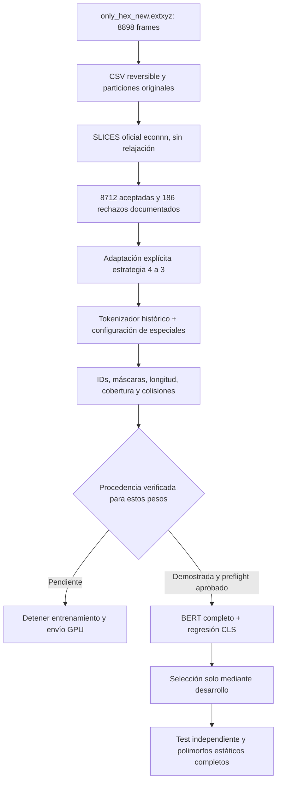

# Flujo de compatibilidad y fine-tuning derivado del paper

Referencia: Alampara, Miret y Jablonka, [Less can be more for predicting properties
with large language models](https://doi.org/10.1038/s43588-026-01045-2).
Se archivaron el artículo, el suplemento y el [código publicado en Zenodo](https://doi.org/10.5281/zenodo.21151839),
con comprobación del MD5 publicado del ZIP. No se descargaron nuevamente los pesos.

## Protocolo aplicado

La política local usa los datos DFT-GGA de la tesis como etiquetas de energía por
átomo. Mantiene las particiones originales agrupadas por composición. La opción
de cinco pliegues opera únicamente dentro del train original; no reemplaza el test
independiente. Son adaptaciones explícitas al dataset de la tesis, no una réplica
literal del benchmark de propiedades utilizado en el artículo.

## Evidencia comprobada

Las 8.712 entradas SLICES válidas coinciden con `__call__` del tokenizador histórico
de 2024 bajo Transformers 4.38.2. Se comprobó el vocabulario de Zenodo, el orden de
especiales de la configuración archivada, la envoltura CLS/SEP, las máscaras y
toda la conversión de grafos. Longitud máxima: 401; ninguna entrada se truncó.
Las 186 exclusiones corresponden a validación SLICES anterior, no a tokenización.

Se observaron 2.853 entradas tokenizadas únicas y 1.119 grupos repetidos. Ningún
grupo fusiona cadenas SLICES diferentes: las colisiones observadas proceden de la
representación de origen. Tampoco hubo colisiones entre familias de polimorfos
estáticos de una misma composición. Los frames físicamente distintos se conservan.
El límite descriptivo calculado con etiquetas de entrenamiento es una propiedad
de la representación y no se presenta como resultado de un predictor.

## Por qué queda pendiente la procedencia exacta

| Evidencia | Observación y alcance |
| --- | --- |
| Histórico Hugging Face | Se inspeccionaron cinco revisiones. No contienen un tokenizador serializado de la ejecución original. |
| Documentación del tokenizador | El ejemplo por defecto asigna CLS=149/SEP=150; el constructor con la configuración archivada reproduce CLS=151/SEP=152. Elegir el ejemplo por defecto cambiaría la entrada. |
| Configuración de fine-tuning archivada | `finetune2m/slice.yaml` apunta a `slice_pt_30k_rt/checkpoint-23000`. El nombre del YAML no demuestra que corresponda al checkpoint 2m normal publicado. |
| Configuración base de preentrenamiento archivada | Indica `max_position_embeddings=1024`, mientras que los pesos/config locales tienen 512. La línea que lo sobrescribiría con `context_length` está comentada en el código archivado. El suplemento indica contexto SLICES de 512. |
| Matriz de embeddings | Tiene 30.522 filas y los 156 IDs reconstruidos caben en ella. Esto comprueba el rango, pero no identifica qué asignación se utilizó en aquella ejecución. |

Las diferencias anteriores impiden tratar el archivo de código como la
configuración efectiva y completa de la ejecución que produjo estos pesos. La
auditoría distingue compatibilidad con el método publicado de procedencia exacta
del checkpoint; no declara que se haya probado incompatibilidad.

Para levantar el bloqueo hace falta un artefacto original publicado del
tokenizador, o evidencia verificable de los autores vinculada a estos pesos que
establezca vocabulario/IDs y envoltura. La verificación preparada exige fuentes
públicas, hashes y vínculo con el checkpoint; un booleano manual no autoriza GPU.

## Fine-tuning posterior preparado

El código usa `BertForSequenceClassification(num_labels=1)` y carga estrictamente
el encoder local. La cabeza consume CLS a través del pooler BERT y se ajustan el
encoder y la cabeza completos. Se configuraron LR 2e-4, máximo 100 épocas,
paciencia 10 y umbral RMSE de 0,001 eV/átomo, siguiendo el flujo publicado y
documentando las adaptaciones locales en el README del experimento.

El test no selecciona tokenizer, pooling, época o hiperparámetros. La evaluación
energética conserva todos los frames admitidos; la selección de mínimos requiere
las tres familias estáticas de una composición. Los conjuntos incompletos se
reportan como no evaluables. Los checkpoints supervisados se guardarán separados
del original. No se ejecutó entrenamiento científico ni se enviaron jobs GPU.
